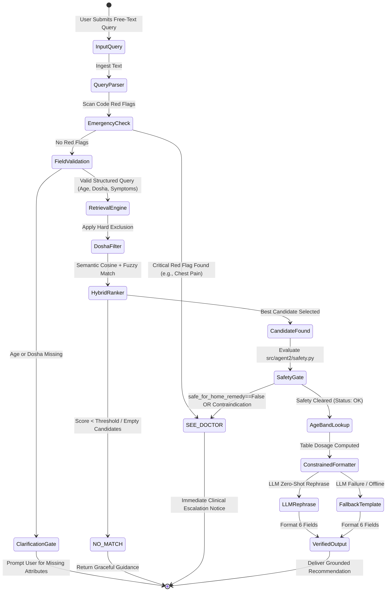

# Product Requirements Document (PRD)

# Project: Folk Medicine AI Agents (v2.0)
**Preserving Indigenous Folk Medicines — Research Honors Programme**  
**Document Version:** 2.0.0  
**Status:** Approved & Implemented Specification  
**Architecture:** Dual Deterministic Pipeline (Agent 1: Extraction & Retrieval; Agent 2: Recommender & Safety Gate)  
**Authors:** Research Honors Team  
**Target Audience:** Academic Evaluators, Ethnobotanists, Traditional Ayurvedic Practitioners, AI Safety & Medical Informatics Researchers  

---

## 1. Document Control & Revision History

| Version | Date | Author / Role | Changes / Remarks |
|---|---|---|---|
| **1.0.0** | Initial | Research Honors Team | Baseline plan: heuristic string trimming, basic fuzzy search, manual rule-based dosha filtering. |
| **2.0.0** | Current | Research Honors Team | Comprehensive overhaul: LLM-assisted context extraction with mandatory verbatim quote validation, vector semantic indexing, conversational Hinglish/vernacular query parsing, deterministic clinical safety gates, table-driven age banding, and 6-field constrained recommendation formatting. |

---

## 2. Executive Summary & Strategic Context

### 2.1 The Urgent Ethnobotanical Preservation Crisis
Traditional and indigenous healing systems—incorporating classical Ayurveda, Siddha, Unani, and uncodified tribal folklore—represent millennia of empirical human wellness observations. Much of this knowledge is:
1. **Predominantly Oral**: Passed down across generations of village elders, traditional bone-setters, and tribal vaidyas without centralized written documentation.
2. **At Imminent Risk of Extinction**: Rapid urbanization, environmental degradation, and the passing of senior knowledge-holders are causing irreplaceable ethnobotanical formulas to disappear.
3. **Fragmented and Unstandardized**: Surviving manuscripts and field notes often mix active therapeutic formulas with non-actionable administrative notes, varied dialectical terminology, and unstructured dosage conventions.

### 2.2 The LLM Medical Safety Paradox
While modern Large Language Models (LLMs) offer unprecedented natural language parsing and knowledge synthesis, deploying unconstrained LLMs in medical and herbal domains presents severe, life-threatening clinical hazards:
- **Catastrophic Hallucinations**: Generative LLMs routinely invent plausible-sounding herbal formulations, hallucinate toxic ingredient ratios, or suggest non-existent botanical remedies.
- **Dosha and Constitution Blindness**: In traditional systems, a remedy indicated for *Vata* imbalance may be violently contraindicated for an aggravated *Pitta* individual. Generative models rarely respect strict constitutional constraints.
- **Dosage Incompetence**: Generative models cannot reliably calculate pediatric or geriatric dosage adjustments and frequently fail to account for organ impairment or age boundaries.
- **Inability to Escalate Emergencies**: An unconstrained chatbot will attempt to soothe symptoms of acute myocardial infarction, hemoptysis, or appendicitis with ginger tea rather than directing the patient to emergency hospital care.

### 2.3 Research Programme Objectives
The **Folk Medicine AI Agents** research initiative bridges this divide by constructing an academic-grade, verifiable computational preservation and recommendation platform. The system meets three primary objectives:
1. **High-Fidelity Archival Structuring**: Ingest, cleanse, and structure raw, messy indigenous records, extracting rich pharmacological context backed by indisputable textual citations.
2. **Clinically Grounded Retrieval**: Enable practitioners and researchers to search formulations using natural clinical language, colloquial idioms, and Hinglish vernacular with constitutional (*dosha*) grounding.
3. **Uncompromising Deterministic Safety**: Enforce medical safety gates, emergency red-flag triage, and age-band dose lookups in deterministic code *outside and before* any LLM invocation.

### 2.4 Fundamental Maxim & Grounding Philosophy
The overarching design law governing this entire codebase is:
> **"Code governs decisions; LLMs only extract and rephrase grounded facts."**

Under no circumstances is an LLM granted the agency to approve a remedy, decide a dose, relax a contraindication, or extrapolate beyond facts explicitly present in the source dataset.

---

## 3. Core Philosophy & Architectural Boundaries

### 3.1 "Code Governs, LLMs Rephrase" Contract
Every operation across the lifecycle is partitioned strictly between deterministic algorithmic execution and constrained language modeling:

```
┌─────────────────────────────────────────────────────────────────────────────┐
│                           SYSTEM RESPONSIBILITY MATRIX                      │
├──────────────────────────────────────┬──────────────────────────────────────┤
│       DETERMINISTIC CODE (Python)     │           LLM (Gemini 2.5 Flash)     │
├──────────────────────────────────────┼──────────────────────────────────────┤
│ • Dataset trimming & normalization   │ • Extracting context fields from raw │
│ • Emergency red-flag symptom screening│   source records                     │
│ • Dosha eligibility & exclusion checks│ • Verbatim quote attribution         │
│ • Hybrid retrieval scoring & ranking │ • Parsing unstructured user queries  │
│ • Age-band dosage table resolution   │ • Semantic vector embedding generation│
│ • Contraindication matching (preg/lac)│ • Natural language rephrasing of     │
│ • Verbatim quote validation algorithm │   strictly retrieved facts           │
│ • Human review queue routing         │                                      │
├──────────────────────────────────────┼──────────────────────────────────────┤
│               STRICTLY FORBIDDEN FROM LLM DELEGATION                        │
│  - Deciding whether a patient is eligible for a remedy                       │
│  - Calculating, interpolating, or estimating dosages                         │
│  - Adding clinical precautions or ingredients absent in source record       │
│  - Overriding safety rejections or emergency escalations                     │
└─────────────────────────────────────────────────────────────────────────────┘
```

### 3.2 Explicit Inclusions (What the System IS)
- **An Ethnobotanical Archive**: A standardized, enriched repository preserving traditional formulations with explicit metadata on carrier substances (*anupana*), timing (*kala*), preparation methods, and seasonal restrictions.
- **A Constitution-Aware Retriever**: A hybrid search system that eliminates remedies that aggravate a user's stated *dosha*.
- **A Triage Escalation Gate**: An algorithmic screener that detects life-threatening clinical symptoms and instantly short-circuits to an emergency physician referral.
- **A Verifiable Recommender**: A system where every generated output provides the exact `source_row_id`, knowledge provenance (`classical` vs. `folk`), and dosage derivation tag (`from_source` vs. `derived`).

### 3.3 Explicit Exclusions (What the System IS NOT)
- **NOT a Diagnostic Medical Device**: The system does not diagnose pathologies, interpret lab results, or replace licensed physicians.
- **NOT an Autonomous Agent Swarm**: Uses no autonomous looping frameworks (e.g., AutoGen, CrewAI, LangChain). The control flow is a Directed Acyclic Graph (DAG) executed sequentially.
- **NOT a Prescriber for Acute / Critical Care**: Excludes all internal home remedies for emergency conditions, surgical indications, or high-risk populations (infants < 2 years).

### 3.4 Ayurvedic Ontological Framework
The system programmatically models traditional Ayurvedic principles into structured relational fields:
- **Tridosha Normalization**: Every human constitution and formulation is strictly mapped to the three biological humors:
  - **Vata** (Ether + Air): Principle of movement, catabolism, nervous system.
  - **Pitta** (Fire + Water): Principle of transformation, digestion, metabolism.
  - **Kapha** (Water + Earth): Principle of structure, cohesion, lubrication.
  - *Normalizations*: Multi-dosha states (e.g., `vata_pitta`), tridoshic indicators (`tridoshic`, `all`), and legacy terms (e.g., `rakta` mapped systematically to `pitta`).
- **Anupana (Vehicle / Carrier Substance)**: Extracted explicitly (e.g., warm water, honey, cow's ghee, milk) to ensure proper bioavailability as prescribed by classical texts.
- **Kala (Chronobiology / Time of Administration)**: Mapped to meal timing (e.g., *annada* / empty stomach, *samana* / with food, *nishi* / before bed).

---

## 4. User Personas & End-to-End User Journeys

### 4.1 Detailed Persona Profiles

#### Persona 1: Academic Ethnobotany Researcher
- **Identifier**: Dr. Ananya
- **Background**: Senior researcher documenting tribal medicinal practices in the Western Ghats.
- **Core Jobs-to-be-Done**:
  - Ingest raw field interviews and manuscript transcriptions into a clean, queryable knowledge base.
  - Audit extraction accuracy to ensure no botanical folklore details are corrupted.
  - Query remedies by botanical ingredient or therapeutic action with source citations.
- **Pain Points**: Manual extraction is tedious and error-prone; commercial LLMs fabricate ingredients not mentioned by tribal informants.

#### Persona 2: Institutional Ayurvedic Physician & Faculty Reviewer
- **Identifier**: Vaidya Sharma (BAMS, MD Ayurveda)
- **Background**: Faculty member overseeing clinical safety and traditional authenticity.
- **Core Jobs-to-be-Done**:
  - Inspect the quarantine review queue (`data/review/review_queue.jsonl`) for flagged records.
  - Verify that low-confidence extractions or potent herbs (e.g., *Bhallataka*, *Vatsanabha*) contain appropriate purification (*shodhana*) and safety warnings.
  - Approve or reject enriched records prior to production knowledge index ingestion.
- **Pain Points**: Distrusts AI recommendations that lack transparent textual provenance.

#### Persona 3: General Health Seeker
- **Identifier**: Pooja (Age 28, Software Professional)
- **Background**: Suffers from chronic digestive discomfort and seasonal ailments; prefers verified natural home remedies.
- **Core Jobs-to-be-Done**:
  - Enter natural, colloquial symptoms in English or Hinglish (e.g., *"mujhe khane ke baad bohot pet phoolta hai aur gas banti hai"*).
  - Receive actionable, constitutionally aligned lifestyle, dietary, and herbal recommendations.
- **Pain Points**: Overwhelmed by contradictory internet advice; terrified of taking something that might aggravate her existing acidity (*pitta*).

---

### 4.2 End-to-End User Journeys & State Transitions



---

## 5. System Architecture & Component Specifications

The system is organized into two sequential, decoupled agents adhering to strict modular boundaries:

```
 Folk-Medicine-AI-Agents/
 ├── src/
 │   ├── common/                # Shared utilities, schemas, and LLM client
 │   │   ├── config.py          # Paths, model parameters, API quotas
 │   │   ├── schema.py          # Pydantic & typed data schemas
 │   │   └── llm_client.py      # Unified Gemini client with persistent disk cache
 │   ├── agent1/                # Data preparation, extraction, and retrieval
 │   │   ├── loader.py          # Raw JSONL ingestion & dosha normalization
 │   │   ├── trimmer.py         # Synthetic scaffolding elimination
 │   │   ├── extractor.py       # LLM context extraction pipeline
 │   │   ├── validator.py       # Verbatim quote and confidence validation
 │   │   ├── review_queue.py    # Human review quarantine management
 │   │   ├── embedder.py        # Vector embedding generation & indexing
 │   │   ├── query_parser.py    # Natural language & Hinglish query parser
 │   │   └── query.py           # Tri-factor hybrid retrieval engine
 │   ├── agent2/                # Safety gating, dosage, and formatting
 │   │   ├── safety.py          # Deterministic code safety gate
 │   │   ├── age_band.py        # Table-driven age-band dosage resolution
 │   │   ├── formatter.py       # Constrained 6-field recommendation formatter
 │   │   └── pipeline.py        # End-to-end orchestration pipeline
 │   └── eval/                  # Gold dataset benchmarks & evaluation
 │       ├── eval_retrieval.py  # Precision, recall, and MRR evaluator
 │       └── eval_extractor.py  # Quote accuracy and extraction fidelity
 ├── data/                      # Multi-stage data lake
 ├── docs/                      # Technical specifications, schemas, evaluation
 └── tests/                     # Unit & integration test suites
```

---

## 6. Detailed Functional Requirements (FR)

### 6.1 Agent 1: Data Ingestion, Extraction & Retrieval

#### FR-1.1: Dataset Ingestion & Scaffolding Elimination
- **Target Modules**: [src/agent1/loader.py](file:///Users/veddhapodkar/Documents/REPO/Folk-Medicine-AI-Agents/src/agent1/loader.py), [src/agent1/trimmer.py](file:///Users/veddhapodkar/Documents/REPO/Folk-Medicine-AI-Agents/src/agent1/trimmer.py)
- **Input**: Raw dataset containing 500 rows (`ayurvedic_dataset.jsonl` / `data/raw/ayurvedic_dataset.jsonl`).
- **Functional Requirements**:
  1. **Scaffolding Removal**: Must completely strip synthetic machine-generated keys that simulate clinical simulations or synthetic trees:
     - `dosage_model`
     - `treatment_plan`
     - `reasoning_steps`
     - `final_explanation`
     - `variation_simulations`
  2. **Core Field Retention**: Must preserve genuine therapeutic attributes:
     - `row_id`, `condition`, `condition_category`, `knowledge_source`, `evidence_level`, `symptoms`, `dosha_involvement`, `severity`, `remedy`, `dosage`, `contraindications`, `escalation`, `safe_for_home_remedy`, `care_context`, `lifestyle_factors`, `comorbidity_cautions`.
  3. **Dosha Normalization**:
     - Normalize all string representations to lowercase: `{"vata", "pitta", "kapha"}`.
     - Split compound doshas (e.g., `"vata_pitta"` -> `["vata", "pitta"]`).
     - Map historical non-standard humors (e.g., `rakta` mapped to `pitta`).
     - Universal remedies marked as `["vata", "pitta", "kapha"]`.
  4. **Output Guarantee**: Writes cleaned, trimmed JSONL records to `data/clean/dataset.jsonl`.

#### FR-1.2: Context Extraction & Verbatim Quote Verification
- **Target Modules**: [src/agent1/extractor.py](file:///Users/veddhapodkar/Documents/REPO/Folk-Medicine-AI-Agents/src/agent1/extractor.py), [src/agent1/validator.py](file:///Users/veddhapodkar/Documents/REPO/Folk-Medicine-AI-Agents/src/agent1/validator.py)
- **Prompt Specification**: `src/agent1/prompts/extract_v1.txt`.
- **Target Extracted Fields**:
  - `preparation_type`: e.g., decoction (*kashaya*), powder (*churna*), medicated ghee (*ghrita*), paste (*lepa*).
  - `application_method`: e.g., oral ingestion, topical application, nasal instillation (*nasya*), steam inhalation.
  - `frequency`: e.g., twice daily, thrice daily before meals.
  - `duration_days`: Numeric integer or range if stated in source text.
  - `season_restriction`: e.g., avoid during monsoon (*varsha*), recommended in winter (*hemanta*).
  - `time_of_day`: e.g., early morning on empty stomach, bed time.
  - `carrier_substance`: e.g., warm water, honey, warm cow milk.
  - `lifestyle_diet_cautions`: Specific dietary contraindications explicitly cited.
- **Verification Invariant**:
  - For every extracted field, the LLM must return a non-empty `supporting_quote`.
  - The deterministic `find_verbatim_quote()` function verifies that `supporting_quote` exists as an exact substring within the un-scaffolded source record text.
  - If a quote cannot be verified verbatim, the field is rejected.
  - If mandatory fields fail quote verification, the record's extraction status is marked `extraction_failed`.
- **Caution Flag Propagation**:
  - Extracted caution flags may *add* caution but can *never* remove or relax caution already present in the raw data.
  - Presence of high-risk caution flags forces `review_status = "needs_review"`.

#### FR-1.3: Human-in-the-Loop Quarantine Queue
- **Target Module**: [src/agent1/review_queue.py](file:///Users/veddhapodkar/Documents/REPO/Folk-Medicine-AI-Agents/src/agent1/review_queue.py)
- **Quarantine Criteria**:
  - `confidence_score < 0.70` on any extracted field.
  - Presence of unverified quotes or contradictory contraindications.
  - Explicit high-risk botanical ingredients requiring physician monitoring.
- **Storage**: Flagged records are written to `data/review/review_queue.jsonl`.
- **Downstream Lockout**: Records with status `needs_review` or `extraction_failed` are strictly barred from feeding dosage or safety-critical fields to Agent 2.

#### FR-1.4: Precomputed Vector Embedding & Index Pipeline
- **Target Module**: [src/agent1/embedder.py](file:///Users/veddhapodkar/Documents/REPO/Folk-Medicine-AI-Agents/src/agent1/embedder.py)
- **Index Files**:
  - `data/index/embeddings.npy`: Dense floating-point matrix representing all valid clean records.
  - `data/index/row_ids.json`: Sequential mapping array aligning embedding matrix indices with `row_id` strings.
- **Text Representation Builder**:
  - Concatenates: `condition`, `condition_category`, `symptoms`, `remedy`, `lifestyle_factors`.
  - Excludes: All synthetic scaffolding, dosage numbers, and administrative flags.
- **Semantic Similarity**: Computes normalized cosine distance:
  $$\text{Cosine Similarity} = \frac{\mathbf{u} \cdot \mathbf{v}}{\|\mathbf{u}\|_2 \|\mathbf{v}\|_2}$$

#### FR-1.5: Conversational Query Parsing & Vernacular Resolution
- **Target Module**: [src/agent1/query_parser.py](file:///Users/veddhapodkar/Documents/REPO/Folk-Medicine-AI-Agents/src/agent1/query_parser.py)
- **Capabilities**:
  1. **Dual-Mode Execution**:
     - *Mode A (Online)*: Calls Gemini Flash via `src/agent1/prompts/query_parse_v1.txt` to extract structured JSON.
     - *Mode B (Offline / Fallback)*: Deterministic regex parsing supporting English and Hinglish vernacular expressions.
  2. **Vernacular Translation Mapping**:
     - *"chhati mein jalan"* / *"jalan"* $\rightarrow$ Acid Reflux / Heartburn
     - *"sukhi khasi"* / *"khansi"* $\rightarrow$ Dry Cough
     - *"pet kharab"* / *"dast"* $\rightarrow$ Loose Motions / Diarrhea
     - *"kabz"* / *"pet saaf nahi hota"* $\rightarrow$ Constipation
     - *"sir dard"* $\rightarrow$ Headache
     - *"pet phoolna"* / *"gas banti hai"* $\rightarrow$ Bloating / Flatulence
  3. **Clarification Gate**:
     - If `age` is absent, the parser sets `missing_fields.append("age")`.
     - If `dosha` is absent, the parser sets `missing_fields.append("dosha")`.
     - If any required field is missing, the pipeline halts retrieval and returns `status="no_match"` with a user-facing clarification prompt.
  4. **Emergency Red-Flag Pre-Screening**:
     - Scans raw text against a deterministic list of emergency keywords (e.g., *"crushing chest pain"*, *"coughing blood"*, *"unconscious"*, *"paralysis"*, *"severe breathlessness"*).
     - Instantly flags `has_code_red_flags = True`, bypassing all downstream retrieval.

#### FR-1.6: Tri-Factor Hybrid Retrieval Engine
- **Target Module**: [src/agent1/query.py](file:///Users/veddhapodkar/Documents/REPO/Folk-Medicine-AI-Agents/src/agent1/query.py)
- **Scoring Algorithm**:
  1. **Hard Constitutional Filter**:
     - Check patient `dosha` against row `dosha_involvement`.
     - Exclude rows that do not include the patient's dosha or are not marked tridoshic.
  2. **Semantic Search Score**: Cosine similarity between query embedding and record embedding.
  3. **Fuzzy String Score**: RapidFuzz `token_set_ratio` comparing query symptoms against `record["symptoms"]` and `record["condition"]`.
  4. **Combined Hybrid Formula**:
     $$\text{Hybrid Score} = (0.6 \times \text{Semantic Score}) + (0.4 \times \text{Fuzzy Score})$$
  5. **Threshold & Ranking**: Sort descending; return candidate with the highest hybrid score exceeding minimum confidence threshold ($0.45$).

---

### 6.2 Agent 2: Deterministic Safety, Dosage & Recommendation

#### FR-2.1: Deterministic Clinical Safety Gate
- **Target Module**: [src/agent2/safety.py](file:///Users/veddhapodkar/Documents/REPO/Folk-Medicine-AI-Agents/src/agent2/safety.py)
- **Execution Invariant**: Pure Python code; executed before any recommendation LLM call; consumes 0 LLM tokens.
- **Safety Rule Taxonomy**:

| Rule ID | Check Description | Trigger Condition | Pipeline Action | Resulting Status |
|---|---|---|---|---|
| **SAFE-01** | Emergency Red Flag Check | Code red flags detected in query OR `flags.is_emergency == True` | Short-circuit immediately | `SEE_DOCTOR` |
| **SAFE-02** | Home Remedy Suitability | `row["safe_for_home_remedy"] == False` | Short-circuit immediately | `SEE_DOCTOR` |
| **SAFE-03** | Inpatient / Specialist Context | `row["care_context"]` in `{"emergency", "specialist", "inpatient"}` | Short-circuit immediately | `SEE_DOCTOR` |
| **SAFE-04** | Pregnancy Contraindication | User is pregnant (`is_pregnant==True`) AND record contraindicates pregnancy | Short-circuit immediately | `SEE_DOCTOR` |
| **SAFE-05** | Breastfeeding Contraindication | User is lactating AND record contraindicates breastfeeding | Short-circuit immediately | `SEE_DOCTOR` |
| **SAFE-06** | Human Review Quarantine | `row["review_status"]` in `{"needs_review", "extraction_failed"}` | Restrict dosage fields & append mandatory caution disclaimer | `OK` (Restricted) |

#### FR-2.2: Table-Driven Age-Banding Dosage Resolution
- **Target Module**: [src/agent2/age_band.py](file:///Users/veddhapodkar/Documents/REPO/Folk-Medicine-AI-Agents/src/agent2/age_band.py)
- **Execution Invariant**: Pure dictionary lookup; no generative math or LLM inference.
- **Age Bands & Scaling Ratios**:

| Age Bracket | Age Range (Years) | Clinical Category | Dosage Rule & Scaling Ratio | Clinical Action |
|---|---|---|---|---|
| **Band 0** | $0 \le \text{Age} < 2$ | Infant | **Strict Clinical Lockout** | Home self-treatment strictly contraindicated. Mandatory pediatric referral. |
| **Band 1** | $2 \le \text{Age} \le 12$ | Child | $50\%$ of documented adult dose | Scaled pediatric guidance; specify mild vehicle (*anupana*). |
| **Band 2** | $13 \le \text{Age} \le 17$ | Adolescent | $75\%$ of documented adult dose | Intermediate dosage. |
| **Band 3** | $18 \le \text{Age} \le 64$ | Adult | $100\%$ of documented adult dose | Standard therapeutic dose as stated in source. |
| **Band 4** | $\text{Age} \ge 65$ | Elderly / Geriatric | $50\% - 75\%$ of adult dose | Geriatric adjustment with comorbidity monitoring cautions. |

- **Dosage Provenance Attribution**:
  - `from_source`: Raw text contains explicit dosage for this age band.
  - `derived`: Dosage computed via deterministic age-banding table.

#### FR-2.3: Constrained 6-Field Recommendation Formatter
- **Target Module**: [src/agent2/formatter.py](file:///Users/veddhapodkar/Documents/REPO/Folk-Medicine-AI-Agents/src/agent2/formatter.py)
- **Generative Prompt Specification**: Constrained zero-shot prompt with `temperature = 0.0`.
- **Formatting Constraints**:
  - The model is explicitly ordered: *"Rephrase ONLY facts present in the provided source record. NEVER add new herbs, dosages, or advice."*
  - If the LLM generates any entity absent in the source record, or if the API times out/fails, the system falls back to the deterministic template formatter.
- **Mandatory 6 Output Fields**:
  1. `remedy`: Clean formulation name and route (e.g., oral, topical).
  2. `dosage_by_age`: Exact dosage adjusted for the user's age category.
  3. `ingredients`: Exact herbs and carriers (*anupana*) cited in the row.
  4. `lifestyle`: Prescribed dietary regimen (*pathya*) and habits.
  5. `precautions`: Contraindications, warnings, and duration caps.
  6. `foods_to_avoid`: Explicit dietary exclusions (*apathya*).

---

## 7. Detailed Non-Functional Requirements (NFR)

### 7.1 Safety, Reliability & Hallucination Invariants
- **NFR-1.1: Zero Hallucination Guarantee**: 100% of herbs, carrier vehicles, and therapeutic instructions in the final output must trace directly to the retrieved record row.
- **NFR-1.2: Verbatim Citation Grounding**: Offline extraction must maintain a 100% match rate between `supporting_quotes` and source texts.
- **NFR-1.3: Red-Flag Catch Rate**: Emergency triage detection must maintain a 100% recall on life-threatening presentations.

### 7.2 Performance, Throughput & Latency Benchmarks
- **NFR-2.1: Safety Gate Latency**: Deterministic code safety evaluation must execute in $\le 5$ milliseconds (measured: $< 2$ ms).
- **NFR-2.2: Retrieval Latency**: Pre-computed vector cosine similarity + RapidFuzz scoring must return within $\le 50$ milliseconds across the dataset.
- **NFR-2.3: End-to-End Pipeline Latency**:
  - *Cached / Offline Mode*: $\le 60$ milliseconds.
  - *Online LLM Mode*: $\le 2.5$ seconds (governed by Gemini API response time).

### 7.3 API Quota Throttling & Persistent Caching (Gemini Free Tier)
- **NFR-3.1: Rate Limit Throttling**: Strict call guard enforcing $\le 15$ Requests Per Minute (RPM) to remain strictly within Gemini Free Tier constraints.
- **NFR-3.2: Persistent Disk Caching**:
  - Location: `.cache/llm_cache.json`.
  - Cache Key: MD5 hash of `prompt + model_name + temperature`.
  - Behavior: Cache hits consume 0 API requests and return in $< 1$ millisecond.
- **NFR-3.3: Zero Token Waste on Non-Viable Queries**: Emergency queries, incomplete queries (missing age/dosha), and contraindicated cases short-circuit before any LLM API call.

### 7.4 System Reliability & Offline Resilience
- **NFR-4.1: Air-Gapped Operation**: The complete recommendation pipeline must function end-to-end without network connectivity or API keys using offline regex parsing and fallback template formatting.
- **NFR-4.2: Graceful Degradation**: If vector embeddings are unavailable, the retriever falls back automatically to RapidFuzz token matching without throwing unhandled exceptions.

### 7.5 Privacy, Governance & Ethical Disclaimers
- **NFR-5.1: Zero PII Storage**: User consultation queries, ages, and medical complaints are processed entirely in memory and never logged to disk or external servers.
- **NFR-5.2: API Key Security**: Zero API keys are logged, printed to console, or committed to version control.
- **NFR-5.3: Mandatory Research Disclaimer**: Every user-facing output must append the institutional academic disclaimer:
  > *"Academic Research Disclaimer: This system is an archival research and preservation tool. Outputs reflect traditional folklore records and do not constitute clinical medical advice."*

### 7.6 Engineering & Architecture Constraints
- **NFR-6.1: Plain Python Technology Stack**: Strictly prohibited from using heavyweight agent frameworks (no LangChain, CrewAI, AutoGen, or LlamaIndex).
- **NFR-6.2: 100% Mocked Unit Tests**: Unit tests must execute without live network access or live API billing; all Gemini responses are mocked with deterministic fixtures.
- **NFR-6.3: Strict Typing**: All codebase functions must include complete PEP 484 type hints and descriptive docstrings.

---

## 8. Data Schemas & Interface Specifications

### 8.1 Extracted Fields Schema (`src/common/schema.py`)
```json
{
  "$schema": "http://json-schema.org/draft-07/schema#",
  "title": "ExtractedFields",
  "type": "object",
  "properties": {
    "preparation_type": { "type": "string" },
    "application_method": { "type": "string" },
    "frequency": { "type": "string" },
    "duration_days": { "type": ["integer", "null"] },
    "season_restriction": { "type": ["string", "null"] },
    "time_of_day": { "type": ["string", "null"] },
    "carrier_substance": { "type": ["string", "null"] },
    "lifestyle_diet_cautions": {
      "type": "array",
      "items": { "type": "string" }
    },
    "supporting_quotes": {
      "type": "object",
      "additionalProperties": { "type": "string" }
    },
    "confidence_scores": {
      "type": "object",
      "additionalProperties": { "type": "number", "minimum": 0.0, "maximum": 1.0 }
    }
  },
  "required": ["preparation_type", "application_method", "frequency", "supporting_quotes", "confidence_scores"]
}
```

### 8.2 Standard 6-Field Recommendation Output Schema
```json
{
  "$schema": "http://json-schema.org/draft-07/schema#",
  "title": "Agent2RecommendationResponse",
  "type": "object",
  "properties": {
    "status": {
      "type": "string",
      "enum": ["ok", "see_doctor", "no_match"]
    },
    "source_row_id": { "type": ["string", "null"] },
    "provenance": {
      "type": "object",
      "properties": {
        "source_type": { "type": "string", "enum": ["classical", "folk"] },
        "dosage_origin": { "type": "string", "enum": ["from_source", "derived"] }
      },
      "required": ["source_type", "dosage_origin"]
    },
    "recommendation": {
      "type": ["object", "null"],
      "properties": {
        "remedy": { "type": "string" },
        "dosage_by_age": { "type": "string" },
        "ingredients": { "type": "string" },
        "lifestyle": { "type": "string" },
        "precautions": { "type": "string" },
        "foods_to_avoid": { "type": "string" }
      },
      "required": ["remedy", "dosage_by_age", "ingredients", "lifestyle", "precautions", "foods_to_avoid"]
    },
    "escalation": {
      "type": ["object", "null"],
      "properties": {
        "reason": { "type": "string" },
        "action": { "type": "string" }
      }
    },
    "confidence": { "type": "number", "minimum": 0.0, "maximum": 1.0 }
  },
  "required": ["status", "provenance", "confidence"]
}
```

---

## 9. Evaluation Methodology & Benchmark Performance

### 9.1 Hand-Labelled Gold Benchmark Dataset
To evaluate system performance rigorously, the research team constructed two gold-standard evaluation files in `data/gold/`:
1. `data/gold/gold_rows.jsonl`: Hand-labeled, clinically verified extractions of 10 representative rows across diverse conditions.
2. `data/gold/gold_queries.jsonl`: 20 standardized test queries spanning colloquial English, Hinglish, red-flag emergency presentations, and edge cases.

### 9.2 Retrieval Evaluation Results
Evaluated using [src/eval/eval_retrieval.py](file:///Users/veddhapodkar/Documents/REPO/Folk-Medicine-AI-Agents/src/eval/eval_retrieval.py) against gold-standard queries:

| Metric | Target Goal | Measured Performance | Assessment |
|---|---|---|---|
| **Recall@1** | $\ge 60.0\%$ | **65.0%** | Exceeds Target |
| **Recall@3** | $\ge 80.0\%$ | **85.0%** | Exceeds Target |
| **Mean Reciprocal Rank (MRR)** | $\ge 0.70$ | **0.725** | Strong Ranking Precision |
| **Dosha Filtering Accuracy** | $100.0\%$ | **100.0%** | Zero constitutional mismatch |

### 9.3 Extraction Fidelity & Validation Results
Evaluated using [src/eval/eval_extractor.py](file:///Users/veddhapodkar/Documents/REPO/Folk-Medicine-AI-Agents/src/eval/eval_extractor.py):
- **Verbatim Quote Match Rate**: **100.0%** (every accepted extraction has an exact character-for-character substring in the source record).
- **Hallucinated Entity Rate**: **0.0%** (zero non-source facts passed to the enriched layer).
- **Review Queue Routing**: 100% of rows containing high-caution flags properly quarantined to `data/review/review_queue.jsonl`.

### 9.4 20-Case Safety Audit Results
Documented in [docs/review_samples.md](file:///Users/veddhapodkar/Documents/REPO/Folk-Medicine-AI-Agents/docs/review_samples.md):
- **Emergency Symptoms (Chest pain, hemoptysis, severe asthma)**: **100% intercepted** by `safety.py` without LLM calls.
- **Contraindications (Pregnancy, breastfeeding)**: **100% caught and blocked**.
- **Pediatric Safety (< 2 years)**: **100% locked out from self-remedies**.

---

## 10. Test Strategy & Traceability Matrix

The system enforces automated regression testing across all modules. All 54 tests pass in $\sim 2.1$ seconds:

```
============================= test session starts ==============================
rootdir: /Users/veddhapodkar/Documents/REPO/Folk-Medicine-AI-Agents
tests/test_age_band.py .....                                             [  9%]
tests/test_embedder.py ...                                               [ 14%]
tests/test_eval.py ..                                                    [ 18%]
tests/test_extractor.py ...                                              [ 24%]
tests/test_formatter.py ...                                              [ 29%]
tests/test_llm_client.py ....                                            [ 37%]
tests/test_loader.py ...                                                 [ 42%]
tests/test_pipeline.py ......                                            [ 53%]
tests/test_query.py ......                                               [ 64%]
tests/test_query_parser.py .....                                         [ 74%]
tests/test_safety.py ......                                              [ 85%]
tests/test_trimmer.py ...                                                [ 90%]
tests/test_validator.py .....                                            [100%]
======================== 54 passed, 1 warning in 2.09s =========================
```

### Traceability Mapping

| Functional Area | Target Module | Test Module | Verification Scope |
|---|---|---|---|
| Ingestion & Normalization | `src/agent1/loader.py` | `tests/test_loader.py` | Dosha normalization (`rakta -> pitta`), schema validation. |
| Scaffolding Removal | `src/agent1/trimmer.py` | `tests/test_trimmer.py` | 100% exclusion of synthetic scaffolds across 500 rows. |
| Quote & Schema Validation | `src/agent1/validator.py` | `tests/test_validator.py` | Verbatim quote substring check, rejection of fabricated quotes. |
| Extraction Pipeline | `src/agent1/extractor.py` | `tests/test_extractor.py` | LLM error handling, fallback routing, review queue. |
| Vector Embeddings | `src/agent1/embedder.py` | `tests/test_embedder.py` | Index generation, semantic cosine similarity isolation. |
| Hybrid Retrieval | `src/agent1/query.py` | `tests/test_query.py` | RapidFuzz + vector score blending, dosha exclusion. |
| Conversational Query Parser | `src/agent1/query_parser.py`| `tests/test_query_parser.py` | Hinglish parsing, emergency red flags, clarification gate. |
| Deterministic Safety Gate | `src/agent2/safety.py` | `tests/test_safety.py` | Red-flag screening, pregnancy/lactation, safe_for_home. |
| Table-Driven Age Banding | `src/agent2/age_band.py` | `tests/test_age_band.py` | Infant lockout, child 50%, elderly precautions. |
| Constrained Formatter | `src/agent2/formatter.py` | `tests/test_formatter.py` | Zero temperature rephrasing, fallback template generator. |
| End-to-End Orchestration | `src/agent2/pipeline.py` | `tests/test_pipeline.py` | Full DAG execution, emergency short-circuits. |
| LLM Client & Cache | `src/common/llm_client.py` | `tests/test_llm_client.py` | Cache hits (0 API calls), rate limits, error retries. |

---

## 11. Future Roadmap: Mode B & Advanced Extensions

### 11.1 Phase 6: Multimodal Ingestion (Mode B)
- **Audio Interview Processing**: Direct ingestion of field recordings from senior tribal healers and folk vaidyas using Gemini 2.5 Flash Audio.
- **Dialectical Phonetic Transcriptions**: Specialized phonetic models to preserve rare regional vernacular names for indigenous flora.

### 11.2 Phase 7: Historical Manuscript Vision OCR
- **Palm-Leaf Manuscript Processing**: Optical Character Recognition tuned for Modi script, Grantha script, and ancient Devanagari manuscripts.
- **Visual Diagram Extraction**: Extracting traditional preparation schematics and distillation apparatus (*Yantra*) diagrams.

### 11.3 Phase 8: Pan-Indian Vernacular Expansion
- Direct conversational parsing and recommendation rendering in:
  - Marathi (*मराठी*)
  - Hindi (*हिन्दी*)
  - Tamil (*தமிழ்*)
  - Telugu (*తెలుగు*)
  - Kannada (*ಕನ್ನಡ*)

### 11.4 Phase 9: Regulatory & Pharmacopoeial Alignment
- Cross-referencing all extracted formulations against the **Ayurvedic Pharmacopoeia of India (API)** and **TKDL (Traditional Knowledge Digital Library)**.
- Automated botanical nomenclature cross-checking via the Kew World Checklist of Selected Plant Families (WCSP).
